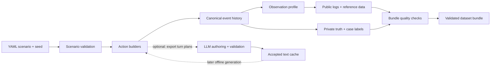

# PretextForge

**Scenario-based synthetic events for testing social-engineering detection.**

Inspired by [EvidenceForge](https://github.com/Cisco-Talos/EvidenceForge),
PretextForge turns social-engineering scenarios into reproducible datasets of
conversations and correlated system events. Define an organization, its routine
activity and a set of incidents in YAML; generate the evidence needed to test how
detection systems distinguish malicious behavior from legitimate work.

Each scenario produces help-desk transcripts alongside identity, ticketing,
telephony, HR and file-activity records. Events share identities, timestamps and
correlation IDs, so a recovery conversation connects to its ticket, approval,
factor change and subsequent login. A separate answer key records the intended
actors, actions and outcomes for evaluating downstream detection results.

## Testing with scenarios

- **Exercise specific behaviors.** Model help-desk impersonation, MFA recovery,
  verification bypass and insider file activity with explicit outcomes.
- **Include legitimate lookalikes.** Place malicious cases among routine support
  requests, authorized recoveries and approved file migrations.
- **Vary evidence availability.** Test the same history with complete collection,
  missing conversations or delayed approvals and HR records.
- **Repeat experiments.** Regenerate identical datasets to compare detection rules
  or models against a stable set of events and labels.

PretextForge supplies the datasets and answer keys; your detection system consumes
`logs/` and `reference.json`. Keep the private labels separate during detection and
use them afterward to assess results.

## What it simulates

| Activity | Details |
| --- | --- |
| Routine work | Seeded login and download volumes, VPN-support calls and chats |
| Identity recovery | Lost-phone and replacement-device requests, manager approval, denied or executed MFA resets |
| Help-desk impersonation | Claimed identities, urgency, verification refusal and requests to bypass approval |
| File activity | Downloads, external sharing, departure notices and authorized migrations |
| Incomplete collection | Missing transcript/telephony groups and delayed ITSM/HR records |

Malicious intent and procedural behavior are separate scenario fields. A legitimate
employee can fail verification; a malicious actor can have an approved request.
The answer key records intent without placing it in public logs or reference data.

The included [mostly benign week](scenarios/benign-heavy-week.md) models **500 users
across 10 departments over five workdays**, with 90 benign and 10 malicious scripted
cases plus routine activity. It produces **122,524 canonical records and 326
conversations** with the supplied seed.

## Quick start

Requirements: **Python 3.12+** and **uv**. Run these commands from the repository root:

```bash
git clone https://github.com/rrouzbeh/pretextforge.git
cd pretextforge
uv sync --locked --group dev

uv run pforge validate scenarios/acme.yaml
uv run pforge generate scenarios/acme.yaml --output output/acme-complete
uv run pforge eval output/acme-complete
```

Start with `output/acme-complete/GROUND_TRUTH.md` for the case outline, then inspect
`logs/` and `quality_report.json`. `eval` returns a nonzero exit status if a bundle
fails validation. Use a fresh output directory for each generation run.

Generate the same history with incomplete collection:

```bash
uv run pforge generate scenarios/acme.yaml \
  --profile degraded --output output/acme-degraded
uv run pforge eval output/acme-degraded
```

Add `--baseline-only` to omit scripted cases and generate routine activity alone.
Template generation needs no model server, GPU or API key.

## How it works



1. **Validate the scenario.** Pydantic models check identities, manager relationships,
   timestamps, action combinations and lifecycle overlaps. YAML loading rejects
   duplicate keys and unsupported fields.
2. **Build a shared history.** Action builders own ticket IDs, active factors,
   sessions, devices, file objects and timestamps. Source emitters serialize those
   facts. Scoped random seeds make workload variation repeatable.
3. **Apply collection conditions.** Each record has an `event_time` and an
   `available_at`. Loss and delay affect observed records while preserving the
   canonical history and labels. Arrival ordering uses a stable tie-break.
4. **Validate and publish.** Independent checks cover schemas, chronology, source
   joins, collection accounting and file hashes. Publication uses a staging
   directory; failed checks prevent a completed bundle from being published.

With the same scenario, seed and accepted text cache, generation is byte-for-byte
reproducible. It makes no model, network or wall-clock calls.

### Example: one recovery, several sources

In [the small example](scenarios/acme.yaml), Dana Ortiz appears in both an
impersonation attempt and a legitimate lost-phone recovery. For the legitimate
recovery, the simulated sequence connects:

- A caller requesting an MFA reset and agreeing to manager verification.
- An ITSM recovery request and manager approval.
- An IdP reset, replacement-factor enrollment and successful login.
- Spoken confirmation after that login, followed by ticket and call closure.

The impersonation case follows its configured verification and execution outcome.
Both cases use the same source schemas. Opaque record IDs and a shared
`correlation_id` connect related evidence; private labels identify the scripted cases.

## Optional LLM text authoring

`render` paraphrases planned utterances through an OpenAI-compatible endpoint and
stores accepted text in a cache. The model controls wording; scenario code owns
participants, actions and outcomes. Restored names and numbers, required behaviors
and approval statements are checked before acceptance.

`generate` reads that cache offline. It derives speech duration and downstream
event timing from accepted wording, validates the result and records model/cache
provenance in the bundle. Cache validation keeps the published conversations aligned
with their scenario plans.

A small real-model cache is included for trying this path without running a model:

```bash
uv run pforge generate scenarios/llm-pilot.yaml --text-mode cached_llm \
  --render-cache examples/llm-pilot-cache --output output/pilot-cached
uv run pforge eval output/pilot-cached
uv run pforge audit scenarios/llm-pilot.yaml \
  --cache examples/llm-pilot-cache --output output/pilot-audit
```

See [the authoring workflow](docs/llm-workflow.md) for rendering, retries and portable
cache export. [The Mac guide](docs/local-mac.md) records a Qwen3.5-4B Q4_K_M run on an
M4 with 16 GB memory, including setup instructions and measured throughput.

## Dataset layout

| Path | Contents |
| --- | --- |
| `logs/*.jsonl` | Six public sources: transcripts, telephony, IdP, ITSM, HR and SaaS files |
| `reference.json` | Public directory, initial identity state and policy |
| `GROUND_TRUTH.json` / `.md` | Private canonical records and case outline |
| `labels/cases.jsonl` | Private intent, procedural status, action points and evidence links |
| `resolved_scenario.json` | Resolved input configuration |
| `MANIFEST.json` | Static file hashes and generation provenance |
| `OBSERVATION_MANIFEST.json` | Record visibility, loss and delay accounting |
| `quality_report.json` / `.md` | Validation results and record counts |
| `TURN_PLANS.json` | Private conversation plans for cached-LLM bundles |

For downstream consumers, `logs/` and `reference.json` are the public evidence
interface. Keep answer keys, resolved scenarios and authoring metadata separate.
Exact fields and timing semantics are documented in [the contract reference](docs/reference.md).

## Validation results

The recorded 500-user workload passed independent quality checks for both collection
profiles, byte-for-byte repeats in fresh processes with different Python hash seeds,
and a baseline-only control.

| Profile | Canonical records | Observed records | Dropped records |
| --- | ---: | ---: | ---: |
| Complete | 122,524 | 122,524 | 0 |
| Degraded | 122,524 | 122,014 | 510 |

The test suite covers corrupted bundles, invalid scenarios, chronology, identity and
session consistency, cache integrity and offline generation. An additional seeded
sweep exercised **80 scenario variations and 23,056 canonical records** without a
validation failure. See [recorded results and methodology](docs/validation.md) for
the workload configuration and reproduction steps.

To run the checks yourself:

```bash
uv run ruff check .
uv run ruff format --check .
uv run pytest -q
uv run python scripts/test_scenario_sweep.py --output output/scenario-sweep.json
uv run python scripts/test_large_scenario.py \
  --scenario scenarios/benign-heavy-week.yaml --output output/large-check
```

The large-workload command uses template text by default. Add `--render-cache PATH`
for a cache authored for that scenario. Timing and peak-memory measurements are
collected by the test runner, outside the deterministic generator.

## Code organization

| Module | Responsibility |
| --- | --- |
| [`models.py`](src/pretextforge/models.py) | Scenario and source contracts |
| [`engine.py`](src/pretextforge/engine.py) | Action expansion, shared state and observation profiles |
| [`conversations.py`](src/pretextforge/conversations.py) | Typed turn plans and utterance validation |
| [`rendering.py`](src/pretextforge/rendering.py) | Explicit model calls, retries and content-addressed caches |
| [`bundle.py`](src/pretextforge/bundle.py) | Staged publication, provenance and answer keys |
| [`quality.py`](src/pretextforge/quality.py) | Independent bundle validation |
| [`auditing.py`](src/pretextforge/auditing.py) | Transcript review packets and accepted-cache export |
| [`cli.py`](src/pretextforge/cli.py) | The seven-command CLI |

Runtime dependencies are Pydantic and PyYAML. Pytest and Ruff support development;
GitHub Actions runs the core checks and a separate manually triggered large workload.

## Documentation

- [Reproduction guide](docs/reproduction.md)
- [Scenario and output contracts](docs/reference.md)
- [Development guide](docs/development-plan.md)
- [Changelog](CHANGELOG.md)
